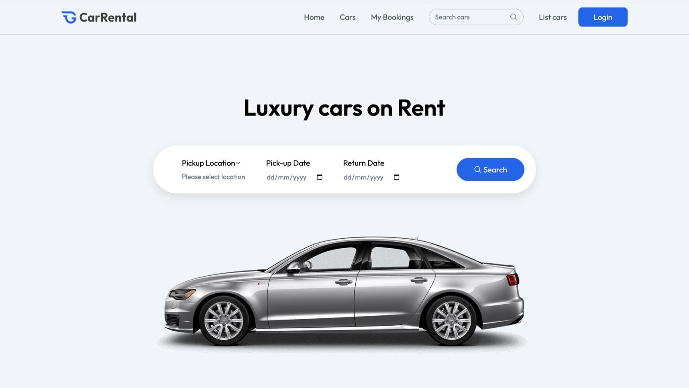
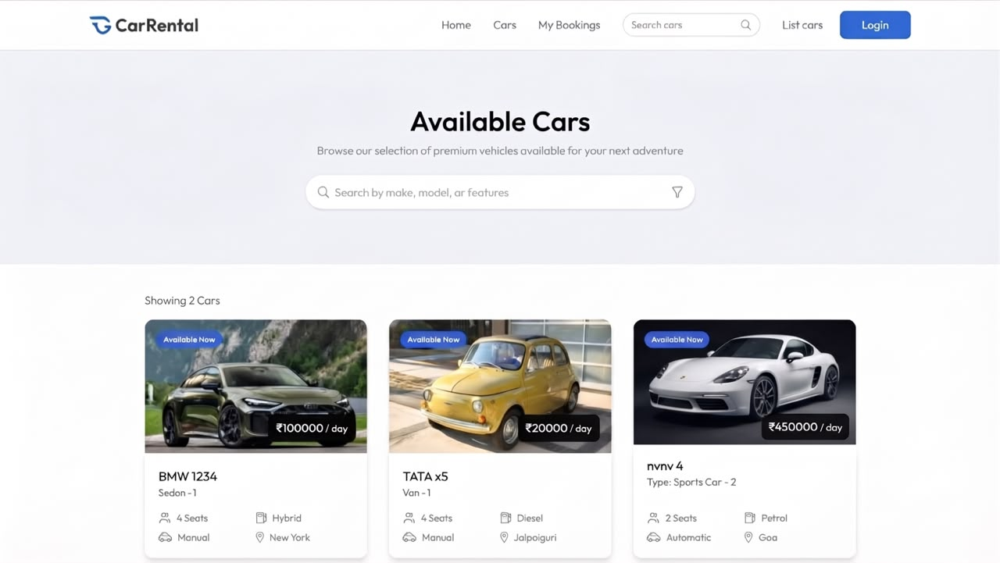
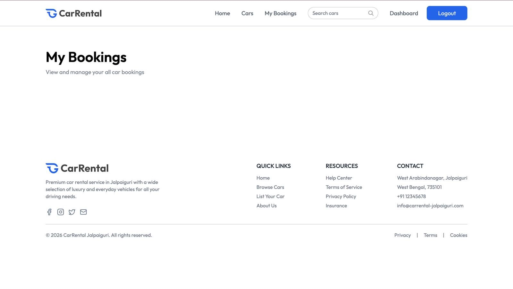
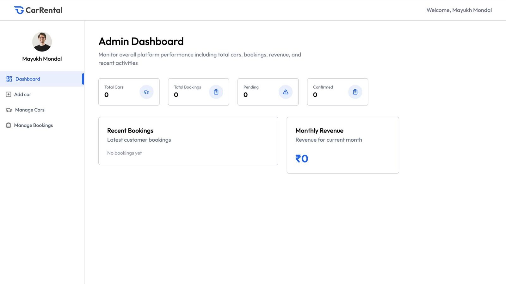
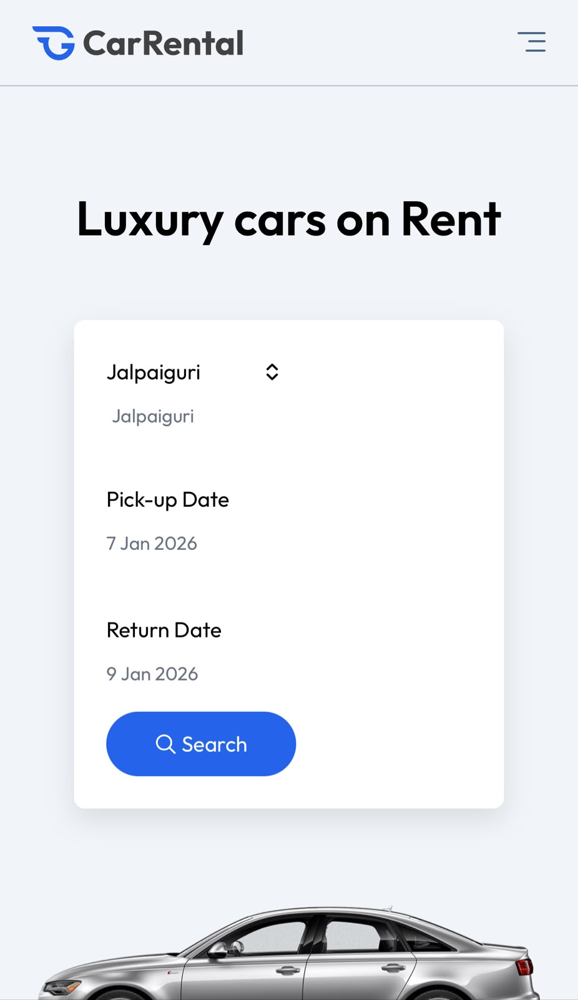

# 🚗 Car Rental

A full-stack car rental platform to browse cars, check availability, book rides, and manage bookings — fast, simple, and secure.

Built with React + Vite + Tailwind CSS on the frontend and Express + MongoDB on the backend.


## ✨ Features

- Browse Cars with Images, Price & Details
- Search & Filter Cars by Type, Price, Location
- Book Car with Date Selection
- User Authentication (Login / Signup) with JWT & Bcrypt
- Booking Management - View / Cancel Bookings
- Image Upload for Cars with Multer + ImageKit
- Smooth Animations with Motion
- Toast Notifications with React Hot Toast
- Currency Support with Environment Variable
- Responsive UI for Mobile & Desktop
- Organized Folder Structure - `client/` + `server/`

## 🛠️ Tech Stack

- **Frontend:** React.js 19, Vite 6, Tailwind CSS v4, JavaScript
- **Routing:** React Router DOM v7
- **HTTP Client:** Axios
- **Animation:** Motion
- **Notifications:** React Hot Toast
- **Backend:** Node.js, Express.js 5
- **Database:** MongoDB with Mongoose 8
- **Authentication:** JWT + Bcrypt
- **Image Upload:** Multer + ImageKit
- **Others:** CORS, Dotenv, Nodemon
- **Tools:** Git, GitHub, VS Code

## 📁 Project Structure

```
car_rental/
├── client/ # React + Vite + Tailwind CSS App
│ ├── src/
│ ├──.env
│ └── http://package.json
├── server/ # Express + MongoDB API
│ ├── models/
│ ├── routes/
│ ├── http://server.js
│ ├──.env
│ └── http://package.json
├──.gitignore
└── http://README.md
```

## 🚀 Getting Started

### 1. Clone the repo

```bash
git clone https://github.com/mayukhmondal42/car_rental.git
cd car_rental
```
2. Backend Setup
```
cd server
npm install
npm run server
```
Create `.env` in `server/`:
```
MONGODB_URI=your_mongodb_uri
JWT_SECRET=your_jwt_secret
IMAGEKIT_PUBLIC_KEY=your_imagekit_public_key
IMAGEKIT_PRIVATE_KEY=your_imagekit_private_key
IMAGEKIT_URL_ENDPOINT=your_imagekit_url_endpoint
PORT=3000
```
3. Frontend Setup
```
cd client
npm install
npm run dev
```
Create `.env` in `client/`:
```
VITE_CURRENCY=₹
VITE_BASE_URL=http://localhost:3000
```
App will run at: `http://localhost:5173`
API will run at: `http://localhost:3000`

📸 Screenshots

<p align="center">
 
</p>
<p align="center">
 
</p>
<p align="center">
 
</p>
<p align="center">
 
</p>
<p align="center">
 
</p>


🔮 Future Improvements

- [ ] Payment Integration (Stripe / Razorpay)
- [ ] Car Location on Map
- [ ] Ratings & Reviews
- [ ] Admin Analytics Dashboard
- [ ] Email Confirmation for Bookings
- [ ] Dark Mode

🤝 Contributing

1. Fork the repo
2. Create your branch: `git checkout -b feature/AmazingFeature`
3. Commit: `git commit -m 'Add some AmazingFeature'`
4. Push: `git push origin feature/AmazingFeature`
5. Open a Pull Request

👨‍💻 Author

*Mayukh Mondal*
- GitHub: https://github.com/mayukhmondal42

⭐ Show your support

If you like this project, give it a ⭐ on GitHub!

Built with ❤️ by Mayukh Mondal
